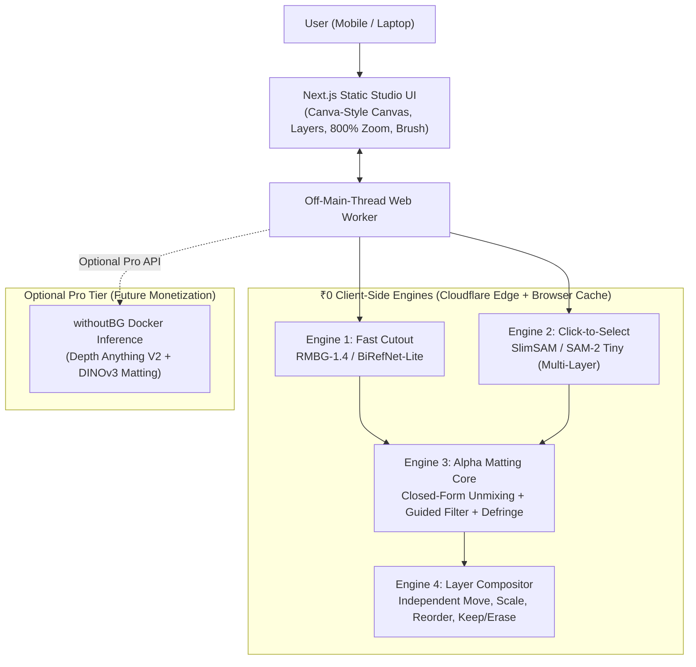

# ClearPixel.ai — Canva-Rivaling Master Engineering Blueprint
**Combining `withoutBG` (Depth-Guided Matting) + `SAM-2 / SlimSAM` + `Alpha Matting` + `Multi-Layer Studio` — Optimized for Mobile, Laptop & Error-Free Cloudflare Deployment**

---

## 1. Executive Summary: How ClearPixel Rivals Canva

To rival **Canva's Magic Studio** (Background Remover + Magic Grab + Layer Editor + Upscaler), ClearPixel combines **4 specialized vision engines** into a single unified pipeline:

1. **Primary Cutout Engine (`withoutBG` / `RMBG-1.4` / `BiRefNet`):** Separates subjects from complex, low-contrast backgrounds (including black-on-black and white-on-white).
2. **Depth-Guided & Alpha Matting Core (`withoutBG` Architecture + Rust WASM):** Uses depth/edge cues + Closed-Form Alpha Unmixing so hair strands and semi-transparent edges never leave halos.
3. **Interactive Object & Person Isolation (`SAM-2 / SlimSAM`):** Lets users click **any individual person or object** (e.g., Person 1, Person 2, Car, Handbag) to extract it into an independent movable **Canva-style Layer**.
4. **Adaptive Cross-Device & Error-Free Cloudflare Hosting:** Runs at **₹0 cost** on user hardware (WebGPU / WASM SIMD) with a proven, zero-error Cloudflare Workers + Static Assets deployment pipeline.

---

## 2. Can We Use `withoutBG` + `SAM-2`? (Honest Engineering Analysis)

### 2.1 `withoutBG` (Depth Anything V2 + DINOv3 + Conv Matting Head)
* **Why `withoutBG` is special:** Standard models fail when hair color matches the background (black hair on black wall). `withoutBG` adds a **Depth Estimation** pass (`Depth Anything V2`) so the model knows *distance*—separating foreground hair from a same-colored wall behind it.
* **License:** Apache-2.0 code + withoutBG Open Model License (check DINOv3 backbone terms for commercial SaaS).
* **Browser vs Server Reality:**
  * Running **Depth Anything V2 + DINOv3 + Matting Head** together requires **~350MB–600MB of weights** and **> 1.5GB RAM**—which will crash **iPhone Safari** (`512MB` tab cap) and slow down 4G mobile users.
  * **Engineering Solution:**
    * **On-Device (₹0 Browser Mode):** Use lightweight **RMBG-1.4 / BiRefNet-Lite** + **Closed-Form Alpha Unmixing** + **SlimSAM** (fits comfortably in mobile & laptop memory).
    * **Optional Pro Cloud API (`withoutBG-inference` Docker):** Deploy `withoutBG` on a Serverless GPU (RunPod / Modal) **only** for a future paid "Studio Pro" button—giving you full `withoutBG` depth-guided cutouts in `< 500ms` without crashing mobile browsers!

### 2.2 `SAM-2` / `SlimSAM` (Interactive Multi-Layer Subject Isolation)
* **Role:** Canva's **"Magic Grab"** equivalent.
* **Browser-Ready Choice:** Full `SAM-2-Large` is ~800MB (too big for browser), whereas **`Xenova/slimsam-77-uniform`** (or **SAM-2 Tiny ONNX**) is **~15MB–35MB** and runs natively in the browser!
* **How it works:**
  1. Image Encoder runs **once** per photo (~400ms on WebGPU).
  2. Every tap/click on Person 1, Person 2, or an object decodes a crisp mask in **< 30ms**, creating a new **Layer** in the Studio!

---

## 3. Unified 4-Engine System Architecture

---

## 4. Mobile & Laptop Execution Matrix (Zero Crashes)

| Device Tier | Execution Engine | Memory Protection | Expected Latency |
| :--- | :--- | :--- | :--- |
| **Desktop / Laptop (Chrome, Edge, Mac)** | **WebGPU** (`16MB` self-hosted `jspi` ORT) | `512×512` tiles, `< 250MB` VRAM | **~300ms – 900ms** |
| **Android Chrome** | **WebGPU** (or **WASM SIMD** fallback) | `256×256` tiles, sequential release | **~1.0s – 2.5s** |
| **iPhone / iPad (iOS Safari)** | **WASM SIMD** (`fp32`/`q8` fallback) | Strict **`< 65MB` WASM heap**, `128px` tiles | **~1.8s – 3.5s** |

### Key Mobile UX Rules:
* **`touch-none` + Pointer Capture** on all canvas interactions (Before/After slider, Layer Drag, Brush) so mobile browsers never hijack swipes for page scrolling.
* **Thumb-Zone Bottom Dock** for one-handed Background, Layers, Brush, and Save controls.

---

## 5. Error-Free Cloudflare Deployment Blueprint (Production-Proven)

To guarantee **zero deployment failures** and **zero runtime CORS/WASM errors** on Cloudflare Workers/Pages:

1. **Strict `< 25 MiB` Asset Rule:**
   - Never bundle `ort-wasm-simd-threaded.asyncify.wasm` (`25.62 MB`) or `jsep.wasm` (`27.04 MB`).
   - Exclude them in `next.config.mjs` via `webpack.IgnorePlugin` and self-host the **`16.03 MB` WebGPU-enabled `ort-wasm-simd-threaded.jspi.{mjs,wasm}`** inside `public/ort/`.
2. **Zero-CORS Same-Origin `/hf/` Worker Proxy (`worker.js`):**
   - Hugging Face omits `Access-Control-Allow-Origin` on `*.workers.dev` for certain repos.
   - `worker.js` proxies `/hf/*` → `https://huggingface.co/*` with `Access-Control-Allow-Origin: *` and `Cache-Control: public, max-age=86400`, while serving all static assets via `env.ASSETS.fetch(request)`.
3. **Clean `_headers` (No `COEP: require-corp`):**
   - Never set `Cross-Origin-Embedder-Policy: require-corp` on static pages unless every third-party CDN sends `CORP: cross-origin` (otherwise `fetch()` fails with `Failed to fetch`).
4. **Static Export (`output: 'export'`):**
   - Root `package.json` builds `packages/clearpixel-web` into `out/`, deployed via `wrangler.jsonc` with **Unlimited Free Static Bandwidth**.

---

## 6. Step-Wise Execution Roadmap to Beat Canva

| Step | Focus | Core Deliverables |
| :--- | :--- | :--- |
| **Step 1 (Done)** | **Foundation & Live Deploy** | Minimalist UI, `RMBG-1.4` + `BiRefNet`, `800%` Zoom/Pan, `Keep/Erase` Brush, Closed-Form Alpha Unmixing + `Defringe`, Cloudflare `/hf/` + `/ort/` live deploy. |
| **Step 2** | **Auto Multi-Person Layer Splitter** | Connected-Components splitter (`< 20ms`, `0 MB` extra) turning separated people/objects into independent movable layers. |
| **Step 3** | **SAM-2 / SlimSAM Magic Grab** | Click-to-select any touching/overlapping person or object into its own layer (`Xenova/slimsam-77-uniform`). |
| **Step 4** | **Canva-Style Layer & Text Canvas** | Drag/Resize/Reorder layers, drop subjects onto templates, add typography behind subjects (Text-Behind-Person effect!), Export Composite or All Layers ZIP. |
| **Step 5** | **Pro Cloud `withoutBG` + Creative Upscale** | Optional Serverless GPU (`withoutBG` Docker + Diffusion Upscaler) when monetizing for Studio Pro users. |
