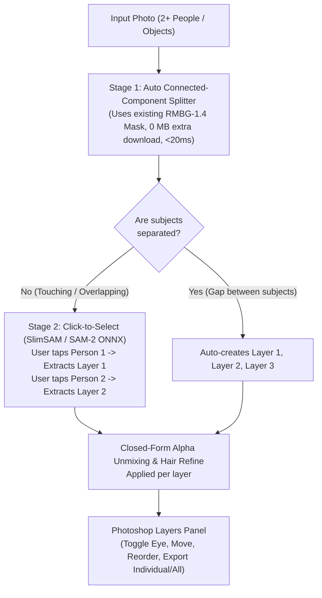

# ClearPixel.ai — Photoshop-Style Multi-Subject Layer Separation Plan

**Goal:** When a photo contains **multiple people or objects** (e.g. 2–3 people, a person + car, products on a table), automatically or interactively separate each subject into **independent editable layers**—just like Photoshop's *Select Subject + Layers Panel*—100% inside the browser at **₹0 server cost**.

---

## 1. Two-Stage Segmentation Architecture (Hybrid Approach)



### Stage 1: Automatic Connected-Component Splitter (Instant, 0 MB Extra)
- **How it works:** Scans the AI foreground mask (`alpha > 128`) using a fast **Union-Find / Two-Pass Connected Components** algorithm (with morphological gap detection).
- **Best for:** Photos where 2–3 people or products have space between them.
- **Cost & Speed:** **< 20ms**, zero extra model download!

### Stage 2: Interactive "Click-to-Select Subject" (`SlimSAM` / `SAM-2` ONNX)
- **Why needed:** If 2 people are standing arm-in-arm or overlapping, connected components sees them as one merged blob.
- **Model:** **`Xenova/slimsam-77-uniform`** (MIT/Apache-2.0, ~10–35MB quantized ONNX, runs natively in `@huggingface/transformers`!).
- **User Flow:**
  1. User clicks **`+ Add Subject Layer`** and taps anywhere on **Person A** (positive point prompt) → `SlimSAM` isolates **Person A** into **Layer 1**.
  2. User taps on **Person B** → `SlimSAM` isolates **Person B** into **Layer 2**.
  3. Optional **Shift+Click** (or `-` button) lets the user exclude an overlapping hand/bag cleanly.
  4. Image encoder runs **once** per photo (~400ms); every subsequent click decodes a new layer mask in **< 30ms**!

---

## 2. Photoshop-Style Layers Panel & Canvas Controls (UI/UX)

```
┌────────────────────────────────────────────────────────┬────────────────┐
│                                                        │  Layers (3)    │
│                                                        │  [+ Pick Subj] │
│              Interactive Multi-Layer Canvas            ├────────────────┤
│         (Click any layer to select / drag / resize)    │ 👁 [🖼] Person 2│
│                                                        │ 👁 [🖼] Person 1│
│                                                        │ 👁 [▫]  Backgnd │
└────────────────────────────────────────────────────────┴────────────────┘
```

### Per-Layer Capabilities:
1. **Visibility Toggle (👁 Eye Icon):** Show or hide any person/object instantly.
2. **Reorder Stack (`↑` / `↓` or Drag):** Move `Person 1` in front of or behind `Person 2` (or insert a text/background layer between them!).
3. **Move & Scale (`Transform`):** Drag `Person 1` closer, resize, or delete `Person 3` completely from the photo.
4. **Per-Layer Brush & Defringe:** `Keep / Erase` brush and `Defringe Hair` apply only to the currently selected active layer!
5. **Flexible Export:**
   - **Export Composite PNG:** All visible layers merged onto chosen background.
   - **Export Selected Layer PNG:** Download only `Person 1.png` with transparent background.
   - **Export All Layers (ZIP):** Client-side JSZip bundle containing `layer-1.png`, `layer-2.png`, etc.

---

## 3. Step-Wise Implementation Plan

| Step | Deliverable | Details |
| :--- | :--- | :--- |
| **Layer Step 1** | **Connected-Components Auto Splitter** | Implement fast Union-Find connected-components labeler in `src/lib/layer-splitter.ts` to auto-split separated subjects from the existing mask. |
| **Layer Step 2** | **Layers State & Inspector UI** | Upgrade `StudioImage` to support `layers: StudioLayer[]` (`id`, `name`, `visible`, `x`, `y`, `scale`, `canvas/url`) + Photoshop-style Layers Panel in `StudioWorkspace.tsx`. |
| **Layer Step 3** | **SlimSAM Click-to-Select Worker** | Add `extractSubjectAtPoint(x, y)` in `pipeline.worker.ts` using `Xenova/slimsam-77-uniform` so overlapping/touching people can be separated with 1 click. |
| **Layer Step 4** | **Per-Layer Move, Brush & Export** | Wire drag-to-move, per-layer `Keep/Erase` brush, and Export Selected Layer / Composite PNG / All Layers ZIP. |
