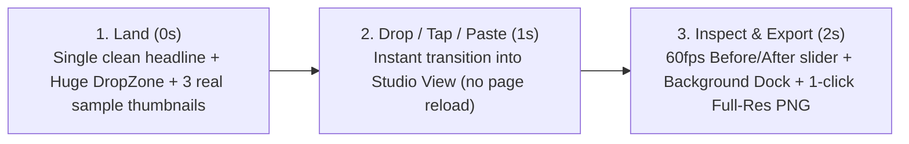

# ClearPixel.ai — High-Level UI/UX Design System & Studio Architecture

**Design Goal:** Create a crisp, Swiss-inspired, tactile image studio that feels like **Apple Photos + Figma + Linear**—faster, cleaner, and more trustworthy than Remove.bg, with **zero "AI-generated" visual clichés**.

---

## 1. Design Philosophy: How to NOT Look "AI-Generated"

Most AI websites look identical and cheap because they overuse generic tropes. ClearPixel.ai follows strict **anti-AI-slop rules**:

| ❌ What We Strictly Avoid (AI Clichés) | ✅ What ClearPixel Uses (Human Studio Craft) |
| :--- | :--- |
| Glowing purple/cyan neon gradients & floating blobs | **Quiet neutral surfaces** (`#FAFAFA` / `#09090B`) with crisp `1px` hairline borders |
| Sparkle icons (`✨`), "Magic AI!" buzzwords | **Direct, functional copy** ("Remove background", "100% on-device", "Original 4000×3000 px") |
| Cluttered 6-card marketing grids above the fold | **Tool-First Hero:** The dropzone and live interactive demo *are* the homepage |
| Heavy drop-shadows & glassmorphism everywhere | **Flat, tactile elevation** (1px borders + subtle `rgba(0,0,0,0.04)` surface contrast) |
| Fake loading spinners with random messages | **Real telemetry:** Actual stage progress (`Preparing engine…`, `Refining edges… 340ms`) |

---

## 2. Visual Design System (Tokens)

### 2.1 Color Palette (Dual-Mode Studio)
* **Light Mode (Landing & Clean Daylight Use):**
  * Background: `#FAFAFA` (Warm Alabaster, softer than harsh `#FFFFFF`)
  * Surface / Cards: `#FFFFFF` with `1px solid #E4E4E7`
  * Primary Text: `#09090B` (Deep Ink)
  * Secondary Text: `#71717A` (Zinc Muted)
  * Primary Action (CTA): `#18181B` (Obsidian Black button, white text — ultra-clean, high-fashion/studio feel)
  * Accent (Active states / Slider): `#2563EB` (Precision Cobalt)
* **Studio Canvas Mode (Editor View):**
  * Canvas Surround: `#F4F4F5` (Light) / `#111113` (Dark Studio) so photos pop naturally without color bias.
  * Alpha Checkerboard: Subtle low-contrast `#FFFFFF` / `#F0F0F2` (Light) or `#1C1C1F` / `#232326` (Dark) — never harsh black/white squares.

### 2.2 Typography
* **UI & Headings:** `Plus Jakarta Sans` or `Inter` (tight tracking `-0.025em` on headings for an editorial look).
* **Technical Metadata:** `JetBrains Mono` / `Geist Mono` for image dimensions (`6000 × 4000`), file size (`12.4 MB`), and speed (`380ms`) — signals precision engineering.

---

## 3. Information Architecture & The "3-Second Rule"

A user should be able to complete their task in **3 steps without reading a manual**:



---

## 4. Screen-by-Screen Layout & Wireframes

### 4.1 Screen 1: Landing / Upload State (Minimalist & Instant)
* **Top Bar (56px height):**
  * Left: Clean typographic wordmark **ClearPixel** + subtle pill `On-Device · Free`.
  * Right: Theme toggle (Light/Dark) + Privacy tooltip (`Images never leave your device`). No noisy navbars, no login walls.
* **Center Stage (Single Viewport, Zero Scroll Needed):**
  * **Headline:** *"Studio cutouts. Zero uploads."* (Max 2 lines, clean typography).
  * **Subtext:** *"Full-resolution background removal in your browser. Private, instant, free."*
  * **Primary DropZone:** Dashed `1.5px` hairline container, centered `+ Upload Image` button, drag-over highlight, and `Ctrl+V` paste hint.
  * **Quick Try Strip:** 3–4 real, diverse sample thumbnails (Portrait with curly hair, Product bottle, Pet fur) so first-time visitors can test in 1 click.

---

### 4.2 Screen 2: Desktop Studio Workspace (Figma-Style)

```
┌─────────────────────────────────────────────────────────────────────────┐
│  ClearPixel   [4000×3000 · 380ms]         [Undo/Redo]  [New]  [Export ▾]│  <- 56px Top Bar
├────────────────────────────────────────────────────────┬────────────────┤
│                                                        │  Background    │
│                                                        │  [▫] [●] [◐]   │
│                                                        │  Swatches      │
│              60fps Interactive Canvas                  │  Blur Slider   │
│         (Before / After Split Slider + Zoom)           ├────────────────┤
│                                                        │  Refine Edges  │
│                                                        │  [Keep] [Erase]│
│                                                        │  Brush Size    │
│                                                        │  Feather       │
├────────────────────────────────────────────────────────┴────────────────┤
│  [100%]  [Fit]  [Hold Space: Original]           WebGPU Accelerated     │  <- 36px Status Bar
└─────────────────────────────────────────────────────────────────────────┘
```

* **80% Canvas, 20% Controls:** The user's photo is always the hero.
* **Right Inspector Panel (280px fixed):** Clean, collapsible sections — Background (Transparent, Solid, Gradient, Blur, Custom Photo) + Refine (Keep/Erase Brush, Edge Feather).
* **Single Primary Action:** Top-right `Export` button with format dropdown (`PNG Full-Res`, `WebP`, `JPG`).

---

### 4.3 Screen 3: Mobile-First Studio (Thumb-Zone Ergonomics)

On mobile (`< 768px`), sidebars are unusable. Everything moves to the **bottom thumb zone**:

```
┌───────────────────────────┐
│ ClearPixel    [New] [Save]│  <- Compact 48px Header
├───────────────────────────┤
│                           │
│                           │
│   Full-Width Touch Canvas │
│   (Pinch Zoom + Split)    │
│                           │
│                           │
├───────────────────────────┤
│ [Background] [Brush] [Fit]│  <- Floating Pill Switcher
├───────────────────────────┤
│  [▫] [■] [■] [■] [Blur]   │  <- Swipeable Bottom Dock
└───────────────────────────┘
```

* **Thumb-Reachable Dock:** Users can switch backgrounds or tap `Save` using one hand.
* **Touch Gestures:** Pinch-to-zoom, two-finger pan, and large `44×44px` hit target on the Before/After slider handle.

---

## 5. Micro-Interactions & Perceived Speed UX

1. **Instant Skeleton Transition:** The moment an image is dropped, it renders immediately on the canvas at 60fps while a crisp, thin top progress bar (`2px` Cobalt line) animates the processing stage — no jarring page jumps.
2. **Tactile Before/After Reveal:** Once processing finishes, the split slider smoothly sweeps across once (or lets the user drag) to showcase the hair/edge cutout.
3. **Hold-to-Compare (`Spacebar` / Long-Press):** Holding `Space` on desktop or long-pressing on mobile temporarily reveals the original image for instant edge inspection.
4. **Haptic-like Visual Feedback:** Buttons use subtle `active:scale-[0.98]` compression (`120ms cubic-bezier(0.2, 0, 0, 1)`).

---

## 6. Step-Wise UI Implementation Plan

| UI Step | Focus | Key Components & Outcome |
| :--- | :--- | :--- |
| **UI Step 1** | **Design Tokens & Layout Shell** | Setup Tailwind theme variables (Light/Dark studio surfaces, `Inter` + `JetBrains Mono`), responsive `Header`, zero-clutter `Landing` shell. |
| **UI Step 2** | **DropZone & Instant Sample Loader** | Drag-and-drop overlay, `Ctrl+V` clipboard paste, file validation, EXIF orientation fix, and 1-click sample photos. |
| **UI Step 3** | **60fps Split Comparison Canvas** | Custom HTML5 `<canvas>` / CSS clip-path viewport with smooth drag slider, zoom/pan, and checkerboard alpha grid. |
| **UI Step 4** | **Desktop Inspector & Mobile Bottom Dock** | Responsive control panel: Background swatches, Bokeh Blur slider, Custom background uploader, and mobile swipeable dock. |
| **UI Step 5** | **Retouch Brush & Export Modal** | Keep/Erase brush cursor preview on canvas + clean Export popover (PNG / WebP / JPG with exact resolution & file size estimate). |
| **UI Step 6** | **Polish, Accessibility & Lighthouse 100** | Keyboard shortcuts (`Space`, `Ctrl+Z`, `Ctrl+S`), ARIA labels, mobile viewport `dvh` fixes, and 60fps stress testing. |
