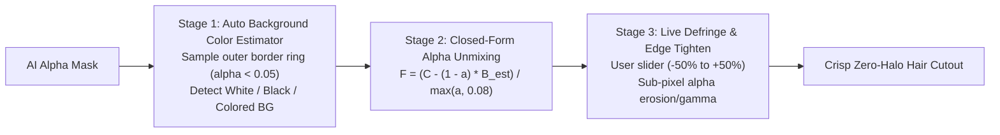
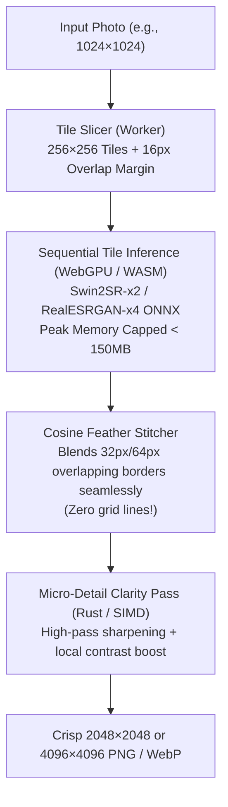

# ClearPixel.ai — Zero-Halo Hair Refinement & AI Upscaler System Design

**Authoring Perspective:** Hugging Face Inference Engineer × Senior Systems/CV Developer × Minimalist Product Designer  
**Goal:**  
1. Eliminate hair-edge halos on **pure white (`#FFF`)** and **pure black (`#000`)** backgrounds with studio-grade precision.  
2. Add an **AI Image Upscaler (2× / 4×)** that rivals **Magnific AI** in sharpness and UX while preserving ClearPixel's **₹0 client-side architecture** (with an optional Pro Generative Diffusion path).

---

## Part 1: Zero-Halo Hair Refinement (White & Black Background Fix)

### 1.1 Why White & Black Backgrounds Leave Hair Fringes
Standard alpha masking fails at extreme luminance boundaries for two opposite physical reasons:

| Background Type | Visual Artifact | Mathematical Root Cause |
| :--- | :--- | :--- |
| **Pure White (`#FFFFFF`)** | Frosty/greyish white glow around dark hair | Bright background light wraps into semi-transparent hair strands ($C = \alpha F + (1 - \alpha) \cdot 255$). Simply keeping $C$ leaves white mixed into the pixel. |
| **Pure Black (`#000000`)** | Muddy dark/black fringe around hair | Low contrast between dark hair and black background causes the model to output $\alpha \in [0.15, 0.45]$ on empty black border pixels. |

### 1.2 The 3-Stage Zero-Halo Engine (`defringe.rs` / `edge-refiner.ts`)

1. **Automatic Background Estimator ($B_{\text{est}}$):**
   - Scans pixels where $\alpha < 0.05$ near the subject's bounding box to compute the median background color $(B_R, B_G, B_B)$.
2. **Closed-Form Color Unmixing (True Matting Equation):**
   - For every boundary pixel ($0.03 < \alpha < 0.95$):
     $$F_{\text{clean}} = \text{clamp}\left(\frac{C_{\text{obs}} - (1 - \alpha) \cdot B_{\text{est}}}{\max(\alpha, 0.08)},\ 0,\ 255\right)$$
   - Simultaneously blends toward nearby definite-foreground hair pigment ($F_{\text{neighbor}}$) when $\alpha < 0.45$ to prevent noise amplification.
3. **Real-Time `Defringe` Slider in Studio Inspector:**
   - Lets the user adjust edge tightness live at 60fps (`0` to `100%`) — tightening residual black/white fringes in 1 drag without re-running the AI model.

---

## Part 2: ClearPixel AI Upscaler (Magnific-Rivaling Architecture)

### 2.1 Honest Engineering Reality: Browser (₹0) vs Cloud GPU (Magnific)

| Capability | Tier 1: On-Device AI Upscaler (₹0 Forever) | Tier 2: Pro Generative Upscale (Future Monetized Tier) |
| :--- | :--- | :--- |
| **Architecture** | **Swin2SR / Real-ESRGAN (ONNX WebGPU)** + Micro-Detail Clarity | **SDXL / FLUX.1 + ControlNet Tile** (Serverless GPU: Modal / RunPod) |
| **Model Size** | ~12MB – 35MB (Runs in browser!) | ~6GB – 12GB VRAM (Cloud GPU required) |
| **Output Style** | **True-to-Original 2× / 4×:** Removes blur, JPEG blocks, sharpens eyes, text, logos, product edges without altering faces | **Creative Hallucination (Magnific-style):** Synthesizes brand-new skin pores, hair strands, fabric weave |
| **Cost** | **₹0.00 / image** | ~₹0.15 – ₹0.50 / image |

> **Strategic Recommendation:** Ship **Tier 1 (₹0 Client-Side 2×/4× AI Upscaler)** now so every user gets blazing-fast, unlimited free upscaling in-browser — and design the UI/API contract cleanly so **Tier 2 (Creative Diffusion)** can plug in later when you monetize.

---

### 2.2 Tier 1 Tiled Upscaling Pipeline (Zero OOM Crashes)

Running a Super-Resolution neural network on a whole `2000×2000` photo at once would require **> 4 GB GPU memory** and crash browser tabs. ClearPixel uses **Overlapping Tile Super-Resolution**:

### 2.3 Recommended MIT / Apache-2.0 Upscaler Models (Hugging Face / ONNX)
1. **`Xenova/swin2SR-classical-sr-x2-64` (Apache-2.0):**
   - Native `@huggingface/transformers` `image-to-image` pipeline!
   - Compact (~12MB–24MB), crisp 2× upscaling, works cleanly on WebGPU and WASM.
2. **`Xenova/swin2SR-realworld-sr-x4-64-bsrgan-psnr` (Apache-2.0):**
   - Specifically trained on real-world noisy/compressed photos (BSRGAN degradation) — removes phone camera noise and JPEG artifacts while upscaling **4×**!
3. **Optional `RealESRGAN_x4plus_anime` / `4x-UltraSharp` ONNX:**
   - Can be added as a preset (`Photo` vs `Illustration / Text`).

---

## Part 3: Minimalist UI / UX Design (Product Designer Spec)

Keeping the exact **Swiss-studio aesthetic** (no AI-slop, tool-first):

1. **Unified Mode Switcher in Top Header:**
   - `[ Remove Background ]` | `[ AI Upscale 2×/4× ]`
   - Same clean `LandingView` DropZone, `Ctrl+V` paste, and sample cards.
2. **Upscaler Studio Controls (Right Inspector / Mobile Dock):**
   - **Scale Selector:** `[ 2× HD ]` `[ 4× Ultra ]`
   - **Detail Clarity Slider:** `0% – 100%` (live client-side micro-contrast & unsharp mask — updates at 60fps without re-running AI!)
   - **Denoise / Artifacts Toggle:** `Clean JPEG Noise`
   - **60fps Before / After Split Slider + `800%` Zoom & Pan:** Users can zoom straight into eyelashes, text, or product logos to compare pixel-for-pixel against the blurry original!
3. **Combo Workflow ("Cutout → Upscale"):**
   - Inside Background Remover, a 1-click **`Upscale Cutout 2×`** button sends the transparent cutout directly into the Upscaler (preserving the alpha channel!).

---

## Part 4: Step-Wise Implementation Plan

| Phase | Deliverable | Engineering Verification Gate |
| :--- | :--- | :--- |
| **Phase A** | **Zero-Halo Hair Engine** | Add Auto Background Color Estimator + Closed-Form Alpha Unmixing (`edge-refiner.ts` + `color_decontamination.rs`) + live `Defringe` slider in `StudioWorkspace.tsx`. Test on pure white & pure black hair photos. |
| **Phase B** | **Tiled AI Upscaler Worker** | Add `upscaleImage()` in `pipeline.worker.ts` using `Xenova/swin2SR-realworld-sr-x4-64-bsrgan-psnr` / `x2` with `256×256` overlapping tiles + cosine feather stitching (memory `< 150MB`). |
| **Phase C** | **Upscaler Studio UI & Clarity Pass** | Add `[ Remove BG | AI Upscale ]` header switcher, `2× / 4×` scale selector, live `Detail Clarity` slider, and `800%` Before/After comparison. |
| **Phase D** | **Cross-Device QA & Deploy** | Verify mobile touch slider, iPhone/Android memory stability, `tsc --noEmit`, `next build` (`< 25 MiB` assets), and push to Cloudflare! |
