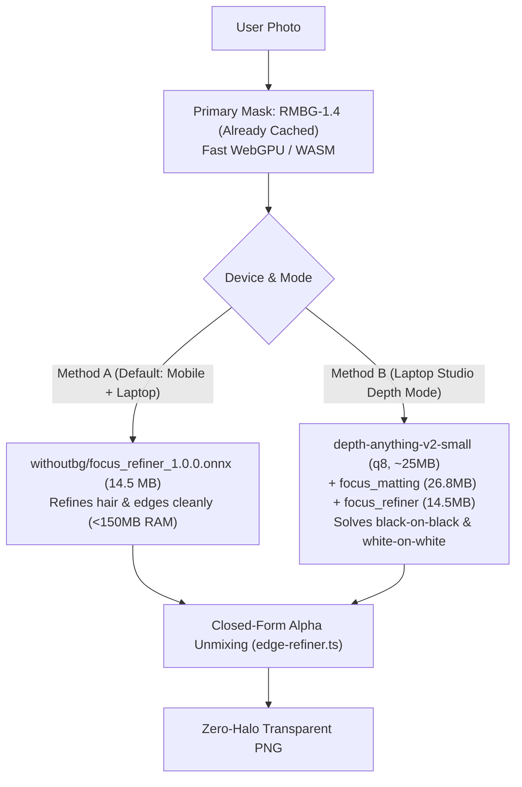

# ClearPixel.ai — `withoutBG` Zero-Cost Browser Integration Plan (`withoutbg.plan.md`)

**Objective:** Evaluate `withoutBG`'s open-weights ONNX models for 100% client-side execution at **₹0 server cost**, ensuring zero crashes on **mobile (iPhone Safari / Android)** and **laptops**, while achieving maximum hair and edge refinement.

---

## 1. Verified `withoutBG` Hugging Face Model Inventory

| Repository | Included ONNX Files | Total Size | Browser Feasibility |
| :--- | :--- | :--- | :--- |
| **`withoutbg/withoutbg-openweights-onnx`** | `withoutbg-open-weights.onnx` (Single unified graph, Opset 18, FP32) | **~454 – 495 MB** | ❌ Too large for browser download & exceeds iPhone Safari (`512MB`) tab memory. |
| **`withoutbg/focus`** (Modular) | • `isnet.onnx` (~177 MB) • `depth_anything_v2_vits_slim.onnx` (~99 MB) • `focus_matting_1.0.0.onnx` (**26.8 MB**) • `focus_refiner_1.0.0.onnx` (**14.5 MB**) | **~317 MB** (Full) **14.5 MB** (Refiner only) | ⚠️ Full set is too heavy for mobile; **`focus_refiner_1.0.0.onnx` (14.5 MB)** is **100% browser & mobile safe!** |
| **`withoutbg/snap`** (Lite) | • `depth_anything_v2_vits_slim.onnx` (~99 MB) • `snap_matting_0.1.0.onnx` • `snap_refiner_0.1.0.onnx` | ~130+ MB | ⚠️ Laptop WebGPU possible; heavy for 4G mobile. |

---

## 2. Why Full `withoutBG` Cannot Run Directly on Mobile Browsers
1. **Download Drop-Off:** Forcing first-time mobile visitors to download 317–454 MB causes immediate bounce.
2. **iOS Safari Memory Ceiling:** iPhone Safari kills tabs exceeding ~512MB–1GB RAM; loading 350MB+ ONNX weights + tensors triggers instant tab reloads.

---

## 3. The ₹0 Smart Hybrid Integration Strategy

Instead of downloading the entire 454 MB bundle, ClearPixel uses `withoutBG`'s modular ONNX components selectively:

### Method A: Lightweight `focus_refiner` (`14.5 MB` — Mobile & Laptop Safe)
- **Pipeline:** `RMBG-1.4` coarse mask → **`focus_refiner_1.0.0.onnx` (14.5 MB)** → `Closed-Form Alpha Unmixing`.
- **Why it works:** Only 14.5 MB extra (cached once via `/hf/` Cloudflare proxy + Browser `Cache API`). Safe on iPhone Safari, Android, and 8GB RAM laptops.

### Method B: Laptop-Only "Studio Depth Mode" (`~110 MB` Quantized)
- **Pipeline:** `RMBG-1.4` + `onnx-community/depth-anything-v2-small` (`q8` ~25MB) + `focus_matting_1.0.0.onnx` (26.8MB) + `focus_refiner_1.0.0.onnx` (14.5MB).
- **Why it works:** **4× smaller** than the 454 MB monolith while preserving depth separation for black hair on black backgrounds. Enabled only on Desktop WebGPU (`>= 4GB` RAM).

### Method C: Future Pro Cloud Tier (Full `withoutbg-openweights`)
- When monetizing later, deploy `withoutbg/withoutbg-openweights-onnx` on a **Free Hugging Face Docker Space (16GB RAM)** or **Modal/RunPod Serverless GPU** for 0-MB client download.

---

## 4. Licensing Summary
- **`withoutBG` Code:** Apache-2.0
- **`withoutBG` Open Weights:** withoutBG Open Model License (Apache-2.0 core + Depth Anything V2 + Meta DINOv3 terms where applicable — review DINOv3 terms before commercial SaaS monetization).

---

## 5. Step-Wise Implementation Plan

| Step | Deliverable | Details |
| :--- | :--- | :--- |
| **Step 1** | **Inspect `focus_refiner_1.0.0.onnx` I/O** | Check input/output tensor names & shapes (`image + alpha` → `refined_alpha`) via ONNX metadata. |
| **Step 2** | **Add `runFocusRefiner()` in `pipeline.worker.ts`** | Load `withoutbg/focus/resolve/main/focus_refiner_1.0.0.onnx` via `/hf/` proxy with `onnxruntime-web` + Cache API. |
| **Step 3** | **Add `Studio Depth Mode` (Optional Desktop)** | Gate `depth-anything-v2-small` + `focus_matting` behind WebGPU desktop detection. |
| **Step 4** | **QA & Cloudflare Deploy** | Verify `< 25 MiB` static assets, test on white/black hair portraits, and push to Cloudflare. |
